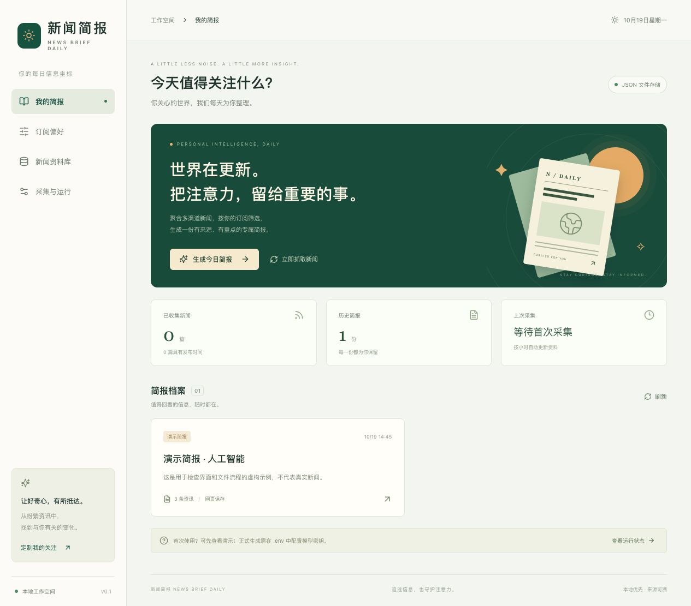

# 新闻简报 · 个性化新闻简报 Agent

按你的兴趣收集新闻，用 LangChain Agent 生成有来源的中文简报。支持前端、CLI、后台调度和邮件推送。所有业务数据使用本地 JSON 文件，不使用数据库。



## 能力

- **通用订阅**：话题、关注关键词、排除关键词、中文/英文新闻、时间范围、条数；AI 是默认模板，也可以订阅财经、汽车、体育等。
- **免费新闻发现**：Bing News RSS、GDELT DOC 2.0、可选 Google News RSS、自定义 RSS。无需新闻搜索 API Key。
- **后台采集**：每小时或每两小时运行，订阅变更后补采；每天回补近期内容，避免仅按整点窗口抓取造成遗漏。
- **正文提取**：Trafilatura 本地提取，保留摘要和提取状态。不能获取正文时不会凭标题编造。
- **LangChain 工具 Agent**：实际注册并使用 `list_dir`、`read_file`、`search_content`、`write_file`、`bash` 五个工具。
- **JSON 存储**：原子替换、文件锁、URL 去重、损坏文件隔离、任务快照、过期清理。
- **定时简报**：按北京时间生成，每日幂等；重启后在当日计划时间起 6 小时内补跑。
- **邮件**：Resend，保存投递结果；失败重试复用已生成简报。
- **前端**：偏好、简报历史、新闻搜索、采集设置、任务状态、Markdown 导出。

## 环境

- Python **3.11–3.14**，建议 **3.12**（锁定依赖在此版本验证）。
- Node.js **20.19+ 或 22+**，npm。
- macOS / Linux；`bash` 工具依赖 `/bin/bash`。Windows 建议使用 WSL2 或 Docker。
- 正式生成需要支持工具调用的 OpenAI 兼容模型。演示、偏好设置、新闻抓取不需要模型密钥。

## 快速启动

在项目根目录执行：

```bash
python3.12 -m venv .venv
source .venv/bin/activate
python -m pip install -c requirements.lock -e '.[dev]'
cp .env.example .env
newsbrief init

npm --prefix frontend ci
npm --prefix frontend run build

newsbrief serve
```

打开 **http://127.0.0.1:8000**。接口文档：**http://127.0.0.1:8000/docs**。

`newsbrief serve` 同时启动网页/API和后台调度，启动后会采集默认订阅。**每日自动生成和邮件推送默认关闭**，在“订阅偏好”中开启。后台任务需要进程持续运行；笔记本休眠期间不能执行。

如果系统只有 `python3`，先检查 `python3 --version`，确认是受支持的稳定版本，再替换第一条命令。

### 先看演示

```bash
newsbrief demo
newsbrief history
newsbrief serve --no-scheduler
```

也可在空白简报页点击“先看一份演示”。演示内容明确标为虚构，不写入新闻资料库，不调用模型、不发送邮件。`--no-scheduler` 仅适合演示和调试，正式使用请去掉。

### 使用真实新闻与模型

编辑 `.env`：

```dotenv
OPENAI_API_KEY=你的模型密钥
OPENAI_MODEL=gpt-4.1-mini
# 其他兼容供应商按需设置，模型必须支持 tool calling
# OPENAI_BASE_URL=https://your-provider.example/v1
```

修改环境变量后需要重启服务。示例模型名称可替换为你账户实际可用、支持工具调用的模型。

```bash
newsbrief prefs --name "小李" --topics "新能源汽车" --keywords "比亚迪" "动力电池" --exclude "招聘" "二手车"
newsbrief collect
newsbrief generate
newsbrief history
```

`collect` 联网抓取；`generate` **只读取本地新闻，不临时搜索互联网**。已有新闻但缺少模型配置时，任务明确失败；没有符合要求的新闻时，保存一份真实的“暂无内容”简报。

## CLI

全局参数放在子命令之前：

```bash
newsbrief --data-dir ./data --json status
```

| 命令 | 用途 |
| --- | --- |
| `newsbrief init` | 初始化默认配置，不覆盖已有数据 |
| `newsbrief prefs` | 查看完整偏好 |
| `newsbrief prefs --file preferences.json` | 校验并导入完整偏好 |
| `newsbrief prefs --topics "财经" --keywords "半导体" --items 8 --hours 48` | 修改订阅 |
| `newsbrief prefs --gdelt-keywords "semiconductor" "BYD"` | 为 GDELT 补充英文检索词 |
| `newsbrief prefs --email "you@example.com" --daily on --mail on --time 08:00` | 开启每日生成与邮件推送 |
| `newsbrief prefs --daily off --mail off` | 暂停每日生成与推送 |
| `newsbrief collect` | 立即补采近期新闻 |
| `newsbrief news --keyword "汽车" --limit 20` | 搜索本地新闻 |
| `newsbrief generate` | 从已有新闻生成简报，默认不发邮件 |
| `newsbrief generate --send` | 生成并发送到本次偏好中的邮箱 |
| `newsbrief history` | 查看历史简报 ID |
| `newsbrief show <简报ID>` | 阅读 Markdown 简报 |
| `newsbrief --json show <简报ID>` | 读取简报完整 JSON |
| `newsbrief send <简报ID>` | 发送或重试同一份正式简报 |
| `newsbrief status` | 新闻数量、模型/邮件配置和来源状态 |
| `newsbrief cleanup` | 立即执行保留期限清理 |
| `newsbrief serve` | 启动网页和调度器 |
| `newsbrief worker` | 仅启动后台调度器 |
| `newsbrief demo` | 创建独立的虚构演示简报 |

用 `--topics` 或 `--keywords` 不带后续值可以清空该列表。命令失败返回非零退出码，适合 bash 脚本编排。

前端、CLI 和后台任务读取同一个 `NEWS_BRIEF_DATA_DIR`。从不同工作目录运行时，建议使用绝对路径，避免误创建另一套数据。

## 邮件配置

在 Resend 创建 API Key，并验证发件域名。配置：

```dotenv
RESEND_API_KEY=你的Resend密钥
MAIL_FROM=News Brief <news@你的已验证域名>
```

配置收件邮箱并开启定时推送，或者手动 `newsbrief generate --send`。Resend 测试域名可能限制收件人，以服务商规则为准。

- 简报先保存，邮件失败不会丢失简报。
- `accepted` 表示邮件服务已接受请求，不等于已到达收件箱。
- 重试复用原收件人、原内容及幂等键；成功提交后不重复发送。
- Resend 的幂等键有服务端有效期。对超过其有效期、结果不确定的投递，请先查服务商记录再手动重试。
- 定时生成/投递最多尝试 3 次，间隔至少 15 分钟；重试窗口为当日计划时间起 6 小时。
- 这里的“免费”主要指新闻发现无需商业 API 套餐；模型、邮件和服务器仍可能产生费用。

## 数据结构

```text
data/
├── config/
│   ├── preferences.json          # 身份、订阅和每日推送配置
│   ├── sources.json              # 渠道、启用状态、频率
│   └── scheduler.json            # 保留天数、查询/提取预算等
├── collector/
│   ├── queries.json              # 确定性的订阅查询计划
│   ├── state.json                # 来源成功/失败、时间和数量
│   └── scheduler_state.json      # 当日清理与回补状态
├── news/<ID前两位>/<ID>.json      # 一篇新闻一个文件
├── briefings/<日期>/<ID>/
│   ├── briefing.json             # 正式简报、偏好/引用快照、投递结果
│   └── briefing.md               # 阅读/导出版本
├── runs/<UTC日期>/<任务ID>.json   # 任务状态、统计、错误
├── workspaces/<任务ID>/
│   ├── preferences.json          # 当次偏好快照
│   ├── candidates/*.json         # 有上限的候选资料快照
│   ├── manifest.json            # 候选目录索引
│   ├── recent.json              # 最近简报摘要
│   ├── draft.json               # Agent 输出
│   └── tool_calls.json          # 工具调用审计
└── .locks/                       # 进程锁文件，不是业务数据库
```

单篇新闻包含：

```json
{
  "schema_version": 1,
  "id": "规范化URL的SHA256",
  "title": "新闻标题",
  "url": "https://example.org/news",
  "canonical_url": "https://example.org/news",
  "publisher": {"name": "原始媒体", "domain": "example.org"},
  "language": "zh",
  "topics": [],
  "published_at": "2026-10-19T01:00:00Z",
  "published_at_source": "rss",
  "first_seen_at": "2026-10-19T02:00:00Z",
  "last_seen_at": "2026-10-19T03:00:00Z",
  "content": {
    "snippet": "来源摘要",
    "text": "提取后的正文",
    "status": "extracted",
    "method": "trafilatura",
    "hash": "正文哈希",
    "attempts": 1,
    "error": ""
  },
  "discoveries": [{
    "provider": "bing",
    "query_id": "查询ID",
    "result_url": "https://example.org/news",
    "provider_seen_at": null,
    "first_seen_at": "2026-10-19T02:00:00Z",
    "last_seen_at": "2026-10-19T03:00:00Z"
  }]
}
```

原文媒体与发现渠道分开。GDELT 的 `seendate` 只进入 `discoveries.provider_seen_at`，不会直接成为 `published_at`。时间统一带时区保存，页面和任务计划使用北京时间。

一条新闻只有标题时不会进入简报；需有至少一定长度的摘要或正文，以及可靠的发布时间。无发布时间的线索仍可在新闻资料库查看。网页元数据只有日期、没有具体时间/时区时，当前实现保守地保持待确认。

## 采集、筛选与清理

1. 从关键词和话题生成稳定查询，默认最多 6 组。常见中文词映射为 GDELT 英文检索词，其他词通过 `gdelt_keywords` 补充。
2. Bing / Google RSS 检索中文或原始关键词；GDELT 使用英文查询和语言条件。
3. 首次/手动补采覆盖订阅时间范围（至少 24 小时）；常规轮询重查最近 6 小时；每天重新回补。
4. 按规范化 URL 哈希合并，去除跟踪参数；同一渠道/查询的发现记录合并更新时间。
5. 正文提取每轮默认最多 30 篇，每篇最多尝试 3 次；每篇最多保存 30000 字符正文。
6. 生成时按时间、语言、排除词、相关性和内容完整度准备最多 60 篇候选，交给 Agent 阅读、筛选、合并事件、生成草稿。
7. 后端验证结构、条数、引用 ID 和重复引用，补齐原文链接，再保存快照。
8. 默认每日 03:00 清理超过 7 天的原始新闻，运行文件默认保留 30 天，历史简报独立长期保留。

写入通过同目录临时文件 + `fsync` + 原子替换完成，读改写过程加文件锁。同类新闻维护任务互斥；生成任务使用副本，不会因清理丢失正在阅读的资料。

**第一版边界：**

- 免费检索没有完整覆盖或可用性保证。GDELT 达到 250 条上限时会标记覆盖不完整，当前未做无限分页/递归拆窗。
- Google News 的部分聚合链接不能直接解析为原文，此时保留 RSS 摘要；不会自动绕过付费墙或验证页面。
- 去重主要按 URL；不同原文 URL 的相似/转载报道由 Agent 合并，不承诺事件级去重完全准确。
- 默认新闻正文提取并发低，采集可能持续数分钟。来源限流/错误后停止该渠道剩余请求，下一轮重试。
- 抓取器拒绝访问私有/保留地址。若代理软件使用 Fake-IP DNS，把公网域名解析成 `198.18.x.x` 或私有 IPv6，请在 `.env` 中设置实际 `NEWS_BRIEF_HTTP_PROXY`，由可信代理解析域名；不要关闭地址检查。代理本身应限制对内网目标的访问。
- JSON 全文遍历适合单用户、小规模和短保留期，未设计大规模多用户检索。
- 单个配置 JSON 损坏会明确报错，需要从备份恢复；损坏的新闻条目会跳过并记录日志。
- 无登录版本默认只监听本机；不要直接暴露到公共网络。远程使用可通过 SSH 隧道，或后续增加认证。
- 后台调度进程只允许一个实例持锁运行。不要使用多个 Uvicorn worker；独立 `worker` 与 `serve` 同时运行时只有一方持有调度器。

## Agent 工具

| 工具 | 行为 |
| --- | --- |
| `list_dir(path)` | 列出任务目录，返回文件名和类型 |
| `read_file(path)` | 读取任务快照，大小与返回长度有限制 |
| `search_content(keyword, dir)` | 搜索 JSON 新闻标题、主题、摘要和正文，返回文件和片段 |
| `write_file(path, content)` | 写入 `draft.json` 或 `notes/`；草稿必须符合结构 |
| `bash(command)` | `/bin/bash` 执行允许的命令：`pwd`、`ls`、`ls -la`、`wc -c draft.json` |

工具路径会解析并验证边界，拒绝目录穿越和逃逸符号链接。模型无法通过工具修改偏好、正式新闻或历史简报。文章内容作为不可信资料处理。`bash` 不继承模型/邮件密钥。

单次 Agent 默认最多 240 秒、最多 28 个图执行步骤和 40 次工具调用。`NEWS_BRIEF_MODEL_TIMEOUT` 控制单次模型请求超时，`NEWS_BRIEF_AGENT_TIMEOUT` 控制 Agent 总时限。

## 前后端开发

终端一：

```bash
source .venv/bin/activate
newsbrief serve --no-scheduler
```

终端二：

```bash
npm --prefix frontend run dev
```

打开 Vite 提示的 **http://127.0.0.1:5173**，`/api` 自动代理到后端。生产方式先构建前端，再由 FastAPI 同源提供静态文件。

HTTP API 示例：

```bash
curl http://127.0.0.1:8000/api/preferences
curl -X POST http://127.0.0.1:8000/api/collect
curl -X POST http://127.0.0.1:8000/api/generate \
  -H 'Content-Type: application/json' -d '{"send":false}'
curl http://127.0.0.1:8000/api/runs
curl http://127.0.0.1:8000/api/briefings
```

耗时任务返回 202 和任务 ID；轮询 `/api/runs/{id}` 获取结果。`failed` 包含错误原因；`skipped` 表示同类任务正运行。

## Docker 常驻运行

```bash
cp .env.example .env
# 编辑 .env，填写模型和可选邮件配置
docker compose up -d --build
docker compose logs -f
```

打开 http://127.0.0.1:8000。命名卷 `newsbrief-data` 持久化全部 JSON。`docker compose down` 不删除数据；不要加 `-v`，除非确实要删除数据卷。容器重启后会恢复配置并检查当天任务。

```bash
docker compose exec newsbrief newsbrief status
docker compose exec newsbrief newsbrief collect
docker compose exec newsbrief newsbrief generate
```

## 检查

```bash
source .venv/bin/activate
ruff check src tests
pytest -q
npm --prefix frontend run format:check
npm --prefix frontend run build
```

测试使用本地固定资料和假的模型响应验证真实 LangChain 工具循环，不消耗模型额度，也不依赖新闻源网络。真实来源、模型供应商及邮件需要在部署环境使用自己的配置联调。

## 上传到 GitHub

`.gitignore` 已排除 `.env`、`data/`、虚拟环境、前端依赖和构建产物。只上传源码、示例环境配置与依赖锁文件。

1. 在 GitHub 创建空仓库，例如 `news-brief-agent`。为方便首次推送，创建时不要勾选初始化 README、License 或 `.gitignore`。
2. 在本项目根目录执行，将下方用户名换成自己的 GitHub 用户名：

```bash
git init
git branch -M main
git add .
git status
# 确认暂存列表中没有 .env、data/ 或真实密钥
git commit -m "Initial implementation of News brief agent"
git remote add origin https://github.com/YOUR_USERNAME/news-brief-agent.git
git push -u origin main
```

GitHub HTTPS 推送使用浏览器/凭据管理器或 Personal Access Token 登录，不使用账户密码。也可以在设置好 SSH Key 后使用 SSH 仓库地址。

如果安装了 GitHub CLI，可以在本地提交后使用：

```bash
gh auth login
gh repo create news-brief-agent --private --source=. --remote=origin --push
```

两种建仓方式选择一种。`gh repo create` 适用于尚未创建远程仓库且尚未添加 `origin` 的情况。

后续更新：

```bash
git add .
git diff --cached --stat
git commit -m "Describe the change"
git push
```

仓库包含 GitHub Actions，会在推送和 PR 时运行 Python 测试、Ruff 与前端构建。这里未替你创建远程仓库或推送代码。
